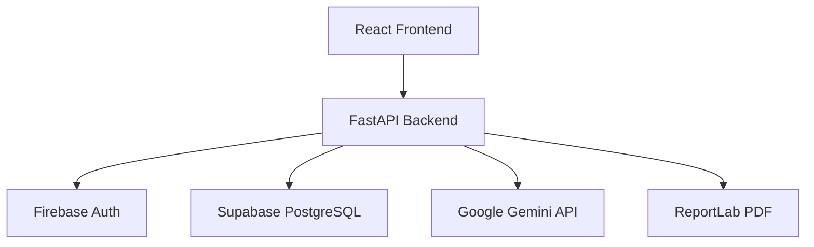

# Festivo AI

[](https://github.com/yourusername/festivo-ai/actions/workflows/ci.yml)

Festivo AI is a GenAI-powered event planning assistant for weddings, birthdays, college
celebrations, and community events. It turns an event brief into an editable budget, timeline,
vendor checklist, and AI-generated improvement proposals while preserving explicit user approval.

**Live Demo:** [https://festivoai01.vercel.app](https://festivoai01.vercel.app)

## Current implementation

The backend is at version **0.8.0** and includes:

- Secure FastAPI foundation with strict validation, safe errors, explicit CORS, and versioned routes.
- Firebase ID-token authentication and owner-scoped event access.
- Event CRUD with timezone-aware date policy and deterministic pagination.
- Decimal-safe budget planning, planned expenses, and optimistic concurrency.
- Deterministic timeline generation and task lifecycle management.
- Vendor checklists, booking status, pricing fields, and comparison.
- Gemini-backed AI planning with validated structured output and safe provider error mapping.
- Persisted planning proposals with stale-snapshot detection, explicit approval/rejection,
  resumable partial approval, idempotent task application, and advisory recommendations.
- Owner-scoped downloadable PDF and CSV event reports.
- Memory and Supabase PostgreSQL repositories with versioned SQL migrations and RLS policies.

The React client lives in [`frontend/`](frontend/README.md). See [`backend/README.md`](backend/README.md)
for backend setup, configuration, endpoints, and security behavior.

## Production readiness

- [x] CI/CD pipeline with automated linting, type checking, and testing
- [x] Security headers and input validation
- [x] Rate limiting and error handling
- [x] Comprehensive test coverage
- [x] Accessibility compliance (WCAG considerations)
- [x] SEO optimization with meta tags and sitemaps
- [x] PWA support
- [x] Docker support for containerized deployment
- [x] Proper documentation and contribution guidelines

## Release documentation

- [Deployment guide](docs/DEPLOYMENT.md)
- [Testing guide](docs/TESTING.md)
- [Security notes](docs/SECURITY.md)
- [Demo script](docs/DEMO_SCRIPT.md)
- [Submission checklist](docs/SUBMISSION_CHECKLIST.md)
- [Architecture](docs/architecture.md)

## Architecture



## Technology stack

**Backend:**
- Python 3.15 (validated interpreter)
- FastAPI, Pydantic v2, and Pydantic Settings
- psycopg 3 for direct PostgreSQL access
- Google Gemini through `google-genai`
- ReportLab for PDF exports
- Firebase Admin SDK for server-side ID-token verification
- pytest with FastAPI TestClient
- Ruff for linting

**Frontend:** React, TypeScript, Vite, Tailwind CSS, React Query, React Router, and related UI tooling.

## Quick start

### Using Docker (Recommended)

```bash
docker-compose up --build
```

### Manual setup

**Backend (Windows):**
```powershell
cd backend
py -m venv .venv
.\.venv\Scripts\python.exe -m pip install --upgrade pip
.\.venv\Scripts\python.exe -m pip install -r requirements.txt
Copy-Item .env.example .env
.\.venv\Scripts\python.exe -m uvicorn app.main:app --reload --host 127.0.0.1 --port 8000
```

**Backend (macOS/Linux):**
```bash
cd backend
python -m venv .venv
source .venv/bin/activate
pip install --upgrade pip
pip install -r requirements.txt
cp .env.example .env
uvicorn app.main:app --reload --host 127.0.0.1 --port 8000
```

**Frontend:**
```bash
cd frontend
npm ci
cp .env.example .env
npm run dev
```

The health and configuration routes start without credentials, but protected product routes require a valid Firebase ID token. Configure `FIREBASE_PROJECT_ID`, `FIREBASE_CLIENT_EMAIL`, and `FIREBASE_PRIVATE_KEY` in `backend/.env`. Do not commit real credentials.

## Reviewer demo account

The deployed frontend provides a **Use demo account** shortcut on the sign-in page:

- Email: `demo@festivoai.com`
- Password: `FestivoDemo@2026!`

This is a dedicated Firebase test account for reviewing the application. Do not store real personal data in it. Firebase password recovery sends a secure reset link, not an OTP; Google-only accounts do not have a password to reset.

Memory storage disappears on restart. To use Supabase PostgreSQL, set `STORAGE_BACKEND=postgres`, configure `SUPABASE_DB_URL` as a server-side secret, and apply migrations:

```powershell
cd backend
.\.venv\Scripts\python.exe scripts\apply_migrations.py
```

```bash
# macOS/Linux
cd backend
source .venv/bin/activate
python scripts/apply_migrations.py
```

## Checks

From `backend/`:
```powershell
.\.venv\Scripts\python.exe -m pytest -q
.\.venv\Scripts\python.exe -m ruff check app tests scripts
```

```bash
# macOS/Linux
python -m pytest -q
python -m ruff check app tests scripts
```

From `frontend/`:
```bash
npm run lint
npm run typecheck
npm test
```

Live Supabase integration tests are skipped unless `TEST_SUPABASE_DB_URL` points to an isolated test database. Never point it at production data.

## Contributing

Please read [CONTRIBUTING.md](CONTRIBUTING.md) for details on our code of conduct and the process for submitting pull requests.

## License

This project is licensed under the MIT License - see the [LICENSE](LICENSE) file for details.

See [docs/architecture.md](docs/architecture.md) for design decisions, security boundaries, and known limitations. Live Supabase, Gemini, and deployed-host checks require credentials and are not represented as complete by the local test suite.
